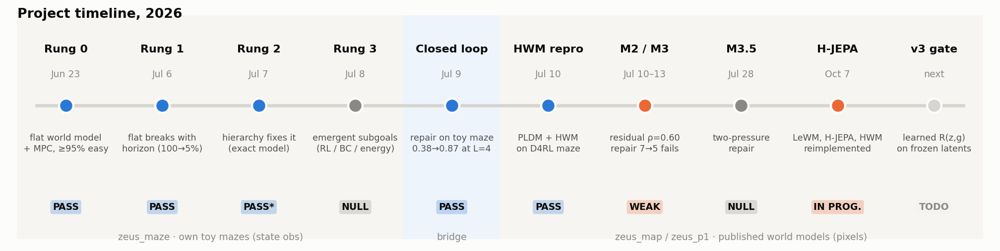
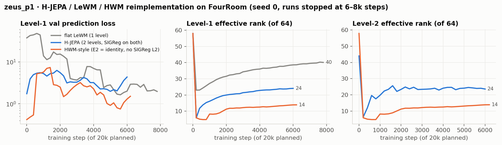

# ECHO — Emergent Closed-loop Hierarchical Optimization

*Research codebase . Status as of **2026-11-02**.*

>  This is the new, canonical repository for the project.** An earlier copy lived on a different
> GitHub account and has been taken down; links to it are dead. All current code, results, and
> updates live here.

 Hierarchical latent world models such as **HWM** (Hierarchical World Models, on top of PLDM)
and **H-JEPA** plan *top-down only*: the high level proposes a subgoal, the low level chases it, and the
high level never learns how badly execution fell short. The low level already computes that shortfall: its
planner's terminal residual. ECHO makes that residual **flow back up** (the "echo"). The result is a
closed loop in which the high level can repair or re-place subgoals in the middle of an episode, instead
of committing to its plan open-loop.





## TL;DR: where we are

| | Result 
|---|---|---|
 **Reproduced flat PLDM and HWM** on D4RL diverse-maze from the public checkpoints (flat 0.975/0.70/0.50 vs paper 1.00/0.63/0.44; HWM medium 1.00 vs 0.95) | solid |
 **Residual is a real reachability signal:** Spearman ρ(r_plan, r_exec) = **0.602** over 528 segments (pre-registered bar: 0.3) | solid |
 **Closed loop works when the signals are good.** Toy maze with oracle high level: open-loop 0.63/0.48/0.38 vs closed-loop **0.95/0.95/0.87** at L = 2/3/4 (all paired 95% CIs exclude 0) | solid, toy setting |
| 🟠 | **Repair on frozen HWM:** failures 7/18 → 5/18 with **2.6× fewer repairs** than always-repair. Same direction at n=6 and n=18 | **not significant** (McNemar p = 0.625) |
| ⚪ | **Two-pressure repair** (reachability + goal progress): null; even the strong-β ceiling only nets −1 failure | solid negative |
| 🔑 | **Diagnosis:** reachability predicts episode failure at AUC **0.64**; oracle goal-progress stall at **0.92**; its latent-space counterpart at ≈ chance. *The loop is starved by its signal, not by the mechanism.* | solid, n=18 |
| 🟠 | **H-JEPA / LeWM / HWM reimplemented from scratch** (`zeus_p1/`, FourRoom, SIGReg). All three train; runs were stopped at 6–8k of 20k steps; no planning eval yet | in progress |
| ⏭ | **Next (v3 gate):** learn a temporal-distance head **R(z,g)** on frozen latents and make it the level interface. Gate: failure-AUC ≥ 0.85 | not run |

**Biggest open holes:** (1) the compute-matched `hwm_replan` baseline is still stubbed, so no Stage-2
claim is publishable without it; (2) all HWM failures come from a budget-cut regime (`n_steps` 500→150), not
from horizon; (3) n=18 is underpowered.

---

## 1. Reimplementations and reproductions

### 1a. HWM / PLDM reproduction
We ran the authors' **HWM_PLDM** code ([kevinghst/HWM_PLDM](https://github.com/kevinghst/HWM_PLDM) @ `e197375`)
on RunPod (RTX 3090) with the frozen public checkpoints: 98×98 image observations, MPPI at both levels,
planner settings matching the paper's Table 14. No upstream training was done. Getting it running took
infra work (the d4rl/mujoco render pipeline, a DataLoader shared-memory crash, a config-key trap, a
multi-chunk `n_envs` crash). Every upstream edit is logged in [`zeus_map/PATCHES.md`](zeus_map/PATCHES.md),
and the patched files are in `zeus_map/pod_backup/pldm/`.


### 1b. H-JEPA / LeWM / HWM from scratch 
This is a clean reimplementation of the three world-model families on a pixel **FourRoom** environment
(64×64, doors closed with p=0.5, 3750 offline episodes), sharing one codebase:
- **flat LeWM**: 1-level JEPA (conv encoder + residual MLP predictor) with **SIGReg** anti-collapse regularization (λ=0.72)
- **H-JEPA**: 2 levels, learned E2 + SIGReg on both levels (λ=0.18), stride 2, learned macro-actions
- **HWM-style**: 2 levels with E2 = identity and no level-2 SIGReg (the level-2 latent *is* the level-1 latent)

Also included: a gradient-based batched planner (flat / projected / hierarchical, `plan.py`) with reachability
logging, linear probes (`probe.py`), and diagnostics for consistency gap and level-2 step norm (`diagnostics.py`).



**Read:** all three train stably. Effective rank shows the expected ordering: the HWM-style model, which has
no SIGReg on level 2, uses the fewest dimensions (14 of 64), H-JEPA uses 24, and flat LeWM 40. **Not yet
done:** finishing training (20k steps), running the planning evaluation, and seeds 1+.

## 2. Our toy ladder (`zeus_maze/`, `scripts/`): why hierarchy, and why closed loop

These experiments use our own state-observation mazes, where ground truth is cheap. The ladder: prove
the floor, find where it breaks, add hierarchy, then ask whether the hierarchy can *emerge*.

| Rung | Claim | Result |
|---|---|---|
| 0 | flat world model + MPC clears easy mazes | ≥ 95%  |
| 1 | flat collapses as horizon L grows | 100% → 5% from L=2 to L=12  |
| 2 | imposed HWM-style hierarchy recovers it | exact model: 75% vs 32% at L=12 . Learned model: hierarchy ≈ flat (the learned coarse model places wall-crossing subgoals) |
| 3 | subgoals *emerge* from planning pressure | REINFORCE ≈ 0, BC 0.07/0.03/0.00, Danskin-energy system 0.07 at L=2. **Null**, but the reachability energy *does* migrate subgoals onto doorways without labels (lift ×66) |
| → | bidirectional closed loop (oracle high level) | **0.38 → 0.87 at L=4**, and the gap widens with horizon  |

<p>
 
 
</p>

The certified bottleneck maze (off-center doorways, so that subgoal placement causally matters) is
documented in [`zeus_maze/CERTIFIED.md`](zeus_maze/CERTIFIED.md).

## 3. Our additions on HWM: test-time residual repair (`zeus_map/repair/`)

All additions are additive and gated by environment variables (`ZEUS_*`). With none set, upstream is
bit-identical. The hook is one line, the subgoal seam `g = l2_result.pred_obs[1]` in `two_lvl_planner.py`.

- **M2: is the residual real?** ρ(r_plan, r_exec) = **0.602**, n=528.  This retired the largest risk.
- **M3: repair operator** `E(g) = α·d(ẑ_T,g) + β·d(F_high(g), z_goal)`. It takes gradient steps on g only,
  with frozen-parameter guards asserted in code.


- **M3.5: why so modest?** We checked which signal actually separates failing episodes:


**The reframe:** failing HWM subgoals are *reachable but misplaced*, so a reachability trigger keys on the
wrong quantity. Goal-progress stall separates failures well, but only when measured with oracle (x,y); in
raw JEPA latent space it is close to chance. Every message in the loop is denominated in raw latent
distance, so the mechanism is **starved by its signal**.

## 4. Next: the gate experiment

Learn **R(z, g) = temporal distance** (steps-to-reach) on the **frozen** level-1 latents. Hindsight
supervision is free: two states k steps apart on an offline trajectory form a pair labelled k. R would then
replace raw latent distance everywhere: as the trigger, as the repair gradient, and as the subgoal score.
`zeus_map/pod_backup/reach_head.py` is built and self-tested; the pod glue (encode trajectories → train R →
failure-AUC) is the next build item.

| failure-AUC of R | meaning | paper |
|---|---|---|
| ≥ 0.85 | the information is in the latent; only the metric was wrong | v3 as planned |
| 0.70–0.85 | partial recovery | mixed, still writable |
| ≤ 0.70 | the frozen encoder discarded control information | "JEPA latents are not plannable" |

**Ordered to-do:** (1) the R gate; (2) the compute-matched `hwm_replan` baseline (the spine); (3) longer
goals (`block_radii=(17,24)`) at the paper budget `n_steps=500`; (4) scale to n=40 with a horizon sweep;
(5) finish the `zeus_p1` runs and evaluate their planning.

---

## Repo map

```
README.md                  ← this update
docs/                      ZEUS_OVERVIEW.md (exact I/O of every rung), zeus_system.html, RUNG0_README.md, master.docx
figures/                   all plots; figures/echo/ = this update (regenerate: python scripts/make_echo_figures.py)
zeus_maze/                 certified bottleneck maze, rung 3 (REINFORCE / BC / Danskin energy), closed_loop.py
zeus_map/                  HWM_PLDM study: repair/ (our code), pod_backup/ (runs, CSVs, analysis, patched upstream
                           files), results/ (M1), runpod/ (setup scripts), STATUS_2026-08-16.md (full ledger)
zeus_p1/                   H-JEPA / LeWM / HWM reimplementation on FourRoom (+ dataset, checkpoints, logs)
models/                    toy-maze checkpoints + all run logs (models/results/)
scripts/                   rung 0–3 drivers and figure scripts
```
