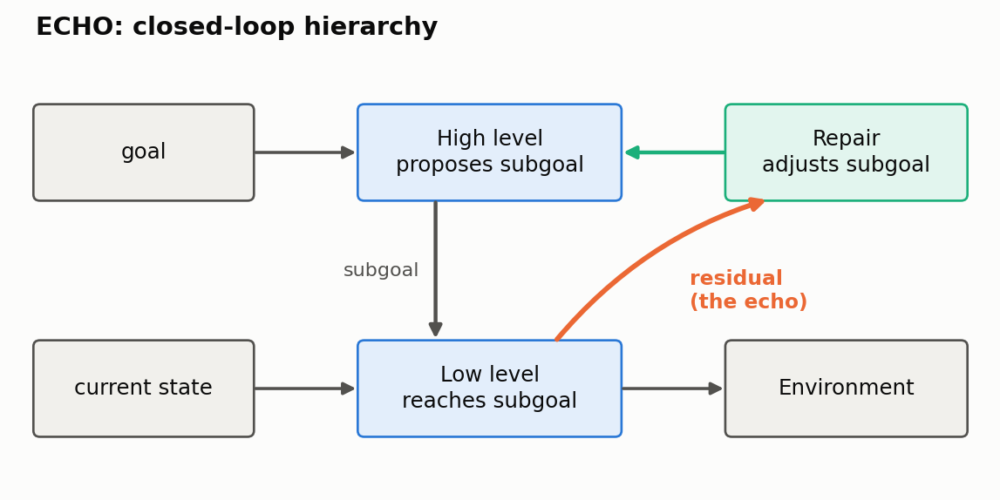
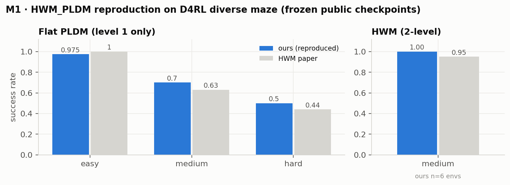
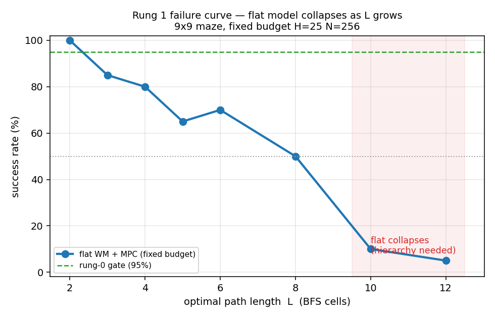
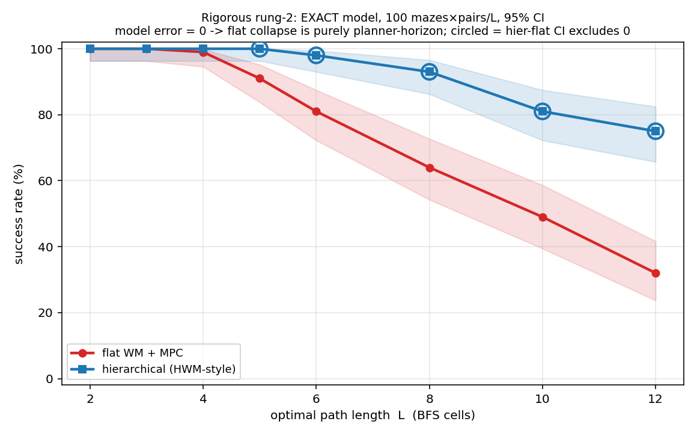
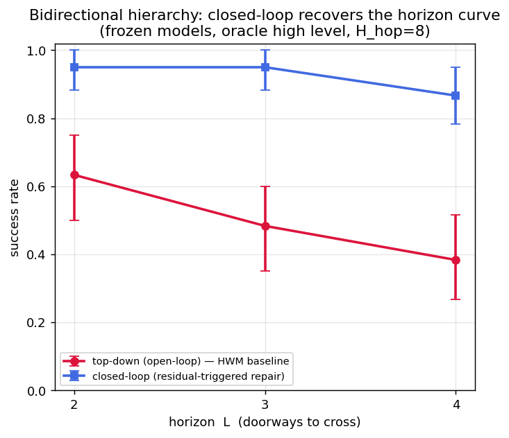
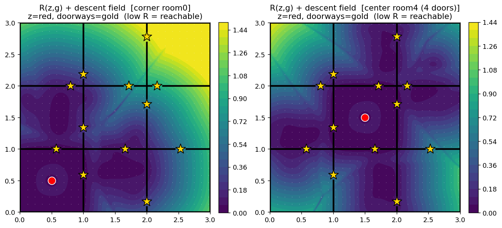
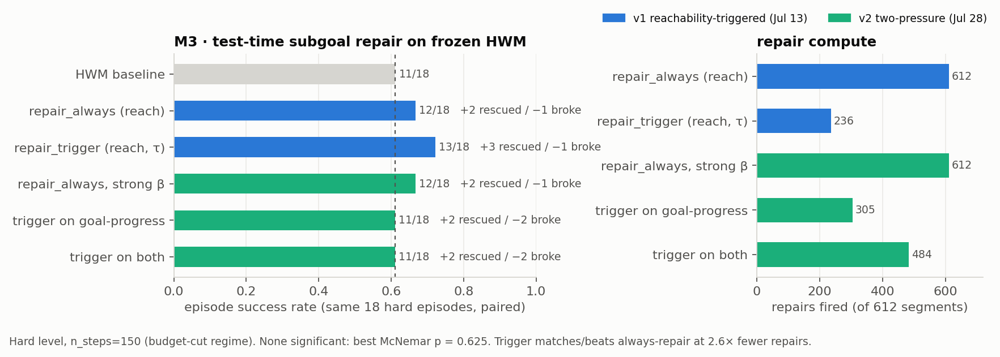
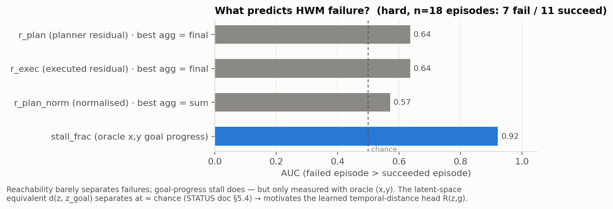

# ECHO — Emergent Closed-loop Hierarchical Optimization

Hierarchical world models (HWM, H-JEPA) plan top-down only: the high level sets a subgoal, the low level
chases it, and the high level never learns whether it was reached. ECHO sends the low-level planning
residual back up, so the high level can repair subgoals mid-episode.

## TL;DR

**ECHO** (independent research): a closed-loop hierarchical world model that feeds low-level planning error back to the high level; reproduced HWM/PLDM on D4RL, found a reachability signal (ρ = 0.60), and more than doubled long-horizon success (0.38 → 0.87) in controlled experiments.

## Results

**Reproductions**
- Reproduced flat PLDM and HWM on D4RL diverse-maze from public checkpoints, matching paper numbers.
- Reimplemented flat LeWM, H-JEPA and HWM from scratch on a pixel FourRoom environment; all three train stably.

**Toy maze ladder**
- Flat planning collapses with horizon: 100% → 5% from L=2 to L=12.
- Imposed hierarchy recovers it with an exact model (75% vs 32% at L=12), but not with a learned one.
- Emergent subgoals (RL, BC, energy-based): null, though the reachability energy moves subgoals onto doorways without labels.
- Closed loop with an oracle high level: **0.38 → 0.87** success at L=4; the gap grows with horizon.

 
 

**Repair on frozen HWM**
- The planning residual predicts execution error: Spearman ρ = **0.60** (n = 528).
- Residual-triggered repair: failures 7/18 → 5/18 with 2.6× fewer repairs than always-repair (not significant yet).
- Diagnosis: failing subgoals are reachable but misplaced. Raw latent distance is too weak a signal to drive the loop.

## Next

- Learn a temporal-distance head R(z, g) on frozen latents and use it as the signal between levels (gate: failure-AUC ≥ 0.85).
- Compute-matched replanning baseline.
- Longer goals, larger n, horizon sweep.
- Planning evaluation for the from-scratch H-JEPA / LeWM / HWM models.
